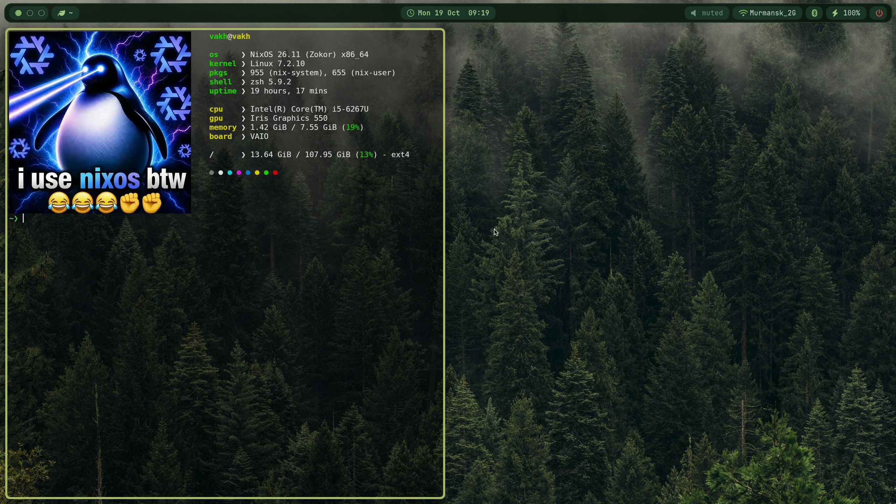

# nixos dots gaming
 
My NixOS setup with [niri](https://github.com/YaLTeR/niri) and an [AGS](https://github.com/Aylur/ags) bar in a dark green forest palette with pre-installed programs and some configs for gaming

if you have nvidia cards, you will have to change the amdgpu module and driver in the boot section and get the nvidia drivers in configuration.nix
 


## Install
 
1. Grab the files
2. Replace `hardware-configuration.nix` with your own (`nixos-generate-config`)
3. Change the username and hostname in configuration,nix
4. Also in configuration.nix, if you have additional disks, scroll down, uncomment the part with disks, fill in the mount path, uuid/label, fs type
5. If you added additional disk, you might want to edit modules/fastfetch.nix at the disk section so fastfetch also would show you their usage
6. Put the files wherever you like and rebuild with flakes(if you are not in the dotfiles directory, change the .#yourhostname to /path/to/dots/#yourhostname):
```bash
sudo nixos-rebuild switch --flake .#yourhostname 
```
7. You can delete README and the screenshot, you dont need them


you can see and edit bindings in modules/niri.nix and shell aliases and extensions at modules/zsh.nix
 
